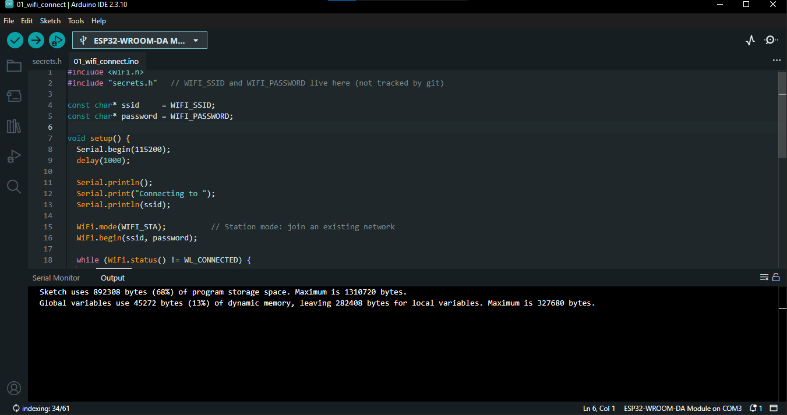
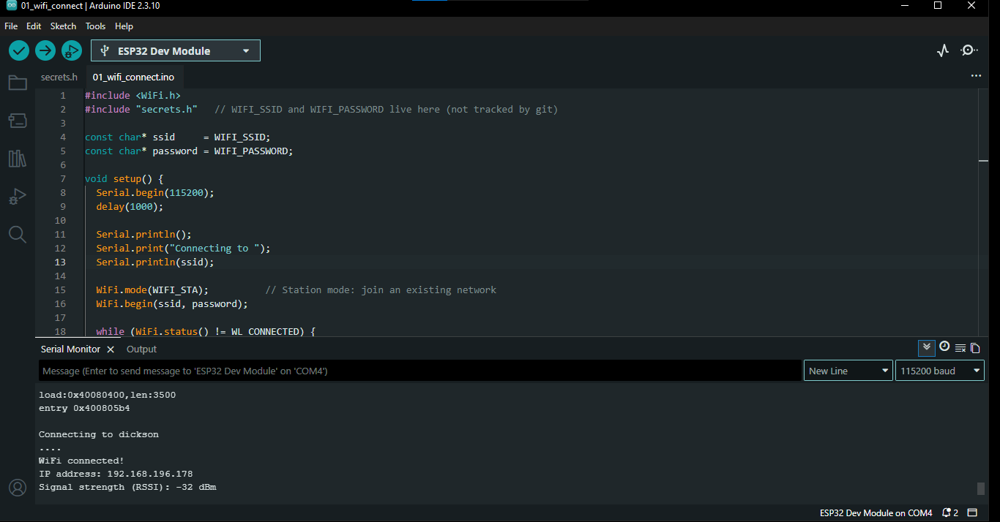

# 01_wifi_connect

## What this sketch does
Connects the ESP32 to a local Wi-Fi network in Station mode, then prints the assigned **IP address** and the **signal strength (RSSI)** to the Serial Monitor. If the connection drops, it reconnects automatically.

This is the first step: nothing else works until the board can join Wi-Fi.

## Files
| File | Purpose |
|---|---|
| `01_wifi_connect.ino` | The sketch |
| `secrets.h` | Your Wi-Fi name and password (create from `../secrets.h.example`, not tracked by git) |

## How to test
1. Open `01_wifi_connect.ino` in the Arduino IDE (**File > Open**). `secrets.h` should appear as a second tab.
2. Select **Tools > Board > ESP32 Dev Module** and the correct **Port**.
3. Click **Verify** (tick icon). Wait for "Done compiling".
4. Click **Upload** (arrow icon). If it hangs on "Connecting...", hold the **BOOT** button until it starts. Wait for "Hard resetting via RTS pin..." or "Done uploading".
5. Open **Tools > Serial Monitor** and set **115200 baud**.
6. Press the **EN** (reset) button on the board.

## Expected result
Serial Monitor output similar to:

```
Connecting to YOUR_WIFI_NAME
.....
WiFi connected!
IP address: 192.168.x.x
Signal strength (RSSI): -55 dBm
```

**Pass:** you see `WiFi connected!` and a valid IP address.

**Optional reconnect test:** turn your hotspot off for about 10 seconds, then on again. The Serial Monitor should print `WiFi lost, reconnecting...` and the board should rejoin.

## Screenshots

### Screenshot 1: Arduino IDE verification and upload successful



### Screenshot 2: Serial Monitor output



## Troubleshooting
- **Only dots, never connects:** wrong SSID or password (case-sensitive), or the network is 5 GHz only.
- **`secrets.h: No such file`:** the file is not in this folder.
- **Upload stuck on "Connecting...":** hold BOOT, and check the port and board selection.
- **Garbled text in Serial Monitor:** set the baud rate to 115200.