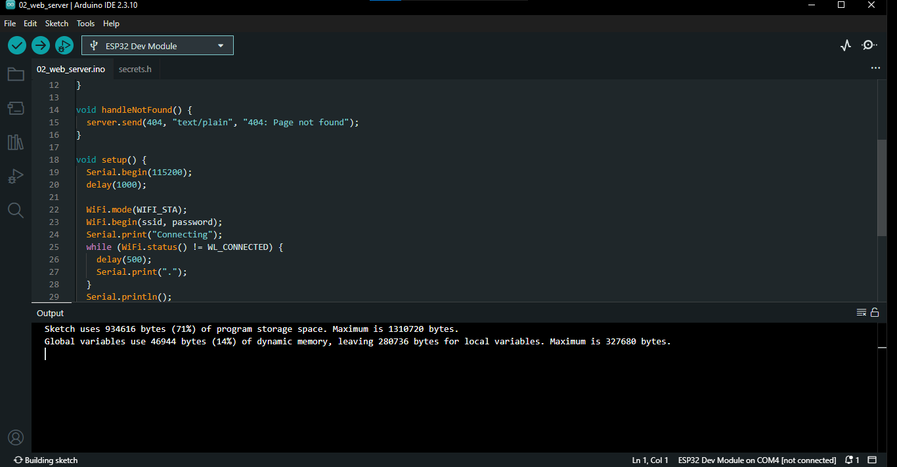
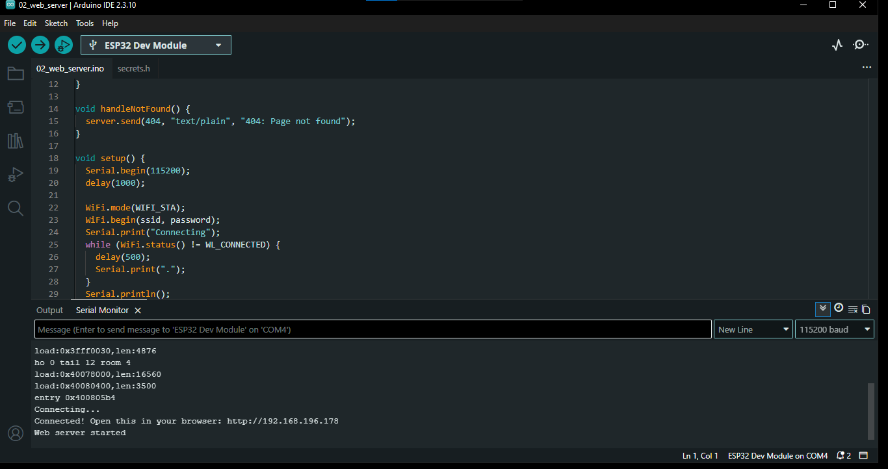
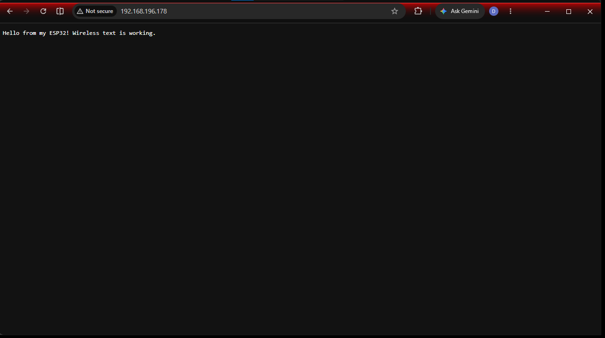

# 02_web_server

## What this sketch does
Connects to Wi-Fi and starts a small **web server** on port 80 using the built-in `WebServer.h` library. When a browser on the same network opens the ESP32's IP address, the ESP32 replies with a plain text message. This proves the ESP32 can send text wirelessly to a computer screen.

| Address | Response |
|---|---|
| `http://<IP>/` | `Hello from my ESP32! Wireless text is working.` |
| `http://<IP>/anything-else` | `404: Page not found` |

## Files
| File | Purpose |
|---|---|
| `02_web_server.ino` | The sketch |
| `secrets.h` | Your Wi-Fi name and password (create from `../secrets.h.example`, not tracked by git) |

## Before you start
1. Complete `01_wifi_connect` first so you know the board can join your network.
2. Copy `../secrets.h.example` into this folder and rename it `secrets.h`, then fill in your details.
3. Put your laptop or phone on the **same 2.4 GHz Wi-Fi network** as the ESP32.

## How to test
1. Open `02_web_server.ino` in the Arduino IDE. `secrets.h` should appear as a second tab.
2. Select **ESP32 Dev Module** and the correct **Port**.
3. Click **Verify**, then **Upload** (hold BOOT if it hangs on "Connecting...").
4. Open the **Serial Monitor** at **115200 baud** and press **EN** (reset).
5. Read the address printed after the dots, for example `http://192.168.1.45`.
6. Type that address into a browser on your laptop or phone.
7. Add `/anything` to the address to check the 404 response.

## Expected result
Serial Monitor:

```
Connecting......
Connected! Open this in your browser: http://192.168.x.x
Web server started
```

Browser:
- **Pass:** the page shows `Hello from my ESP32! Wireless text is working.`
- **Error check:** `http://<IP>/anything` shows `404: Page not found`.

## Screenshots

### Screenshot 1: Arduino IDE verification and upload successful



### Screenshot 2: Serial Monitor output



### Screenshot 3: Browser showing the ESP32 message



## Troubleshooting
- **Page won't open:** the laptop is on a different network, or the network blocks device-to-device traffic (common on campus and guest Wi-Fi). Use your **phone hotspot** (2.4 GHz) for both devices.
- **Browser says "can't reach site":** check the IP in the Serial Monitor again, since it can change after a reset.
- **Page loads slowly or fails sometimes:** check the USB cable and signal strength.
- **`secrets.h: No such file`:** the file is not in this folder.