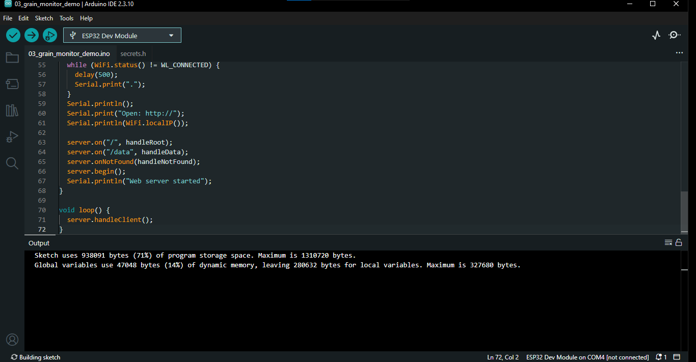
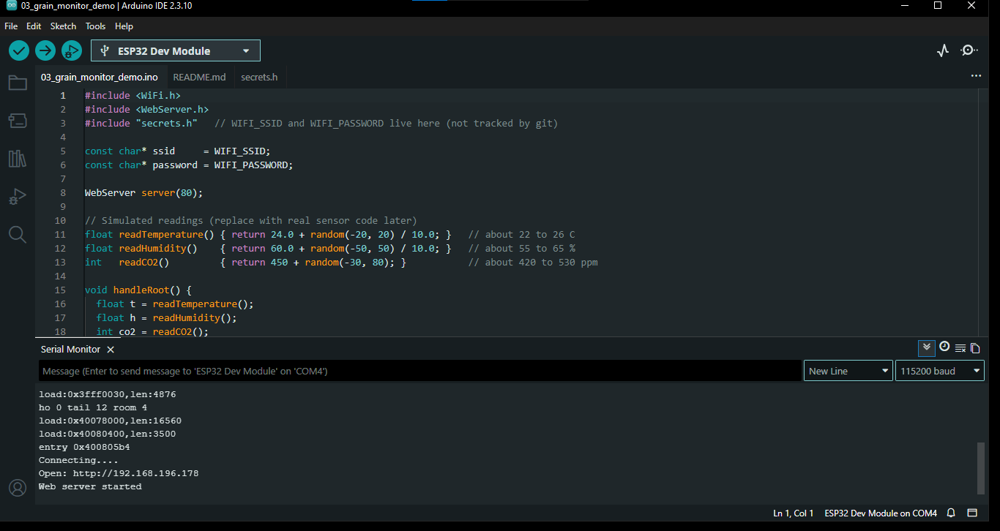
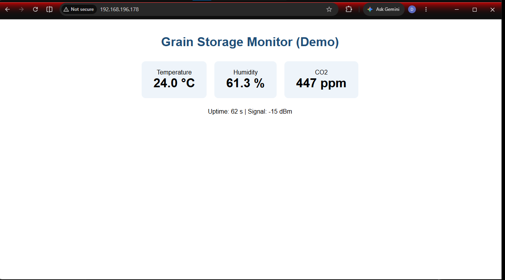
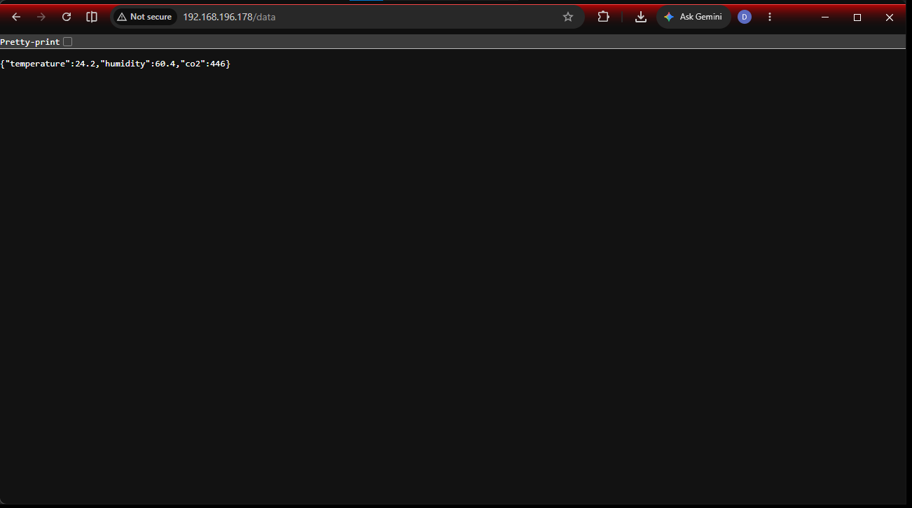

# 03_grain_monitor_demo

## What this sketch does
Runs a web server that shows a live **grain storage monitor page** with three cards: temperature, humidity and CO2. The values are **simulated** (random numbers in a realistic range), so no sensors are needed yet. This shows how the real dashboard will work once real sensors replace the fake values.

The page reloads itself every 3 seconds. The sketch also serves the same readings as **JSON** at `/data`, which a future dashboard or app can read.

| Address | Response |
|---|---|
| `http://<IP>/` | Live page with temperature, humidity and CO2 cards, plus uptime and Wi-Fi signal strength |
| `http://<IP>/data` | Raw JSON, for example `{"temperature":24.6,"humidity":58.2,"co2":471}` |
| `http://<IP>/anything-else` | `404: Page not found` |

Simulated ranges: temperature about 22 to 26 °C, humidity about 55 to 65 %, CO2 about 420 to 530 ppm.

These pages are **display only**. You cannot edit values from the browser in this version.

## Files
| File | Purpose |
|---|---|
| `03_grain_monitor_demo.ino` | The sketch |
| `secrets.h` | Your Wi-Fi name and password (create from `../secrets.h.example`, not tracked by git) |

## Before you start
1. Complete `01_wifi_connect` and `02_web_server` first.
2. Copy `../secrets.h.example` into this folder and rename it `secrets.h`, then fill in your details.
3. Put your laptop or phone on the **same 2.4 GHz Wi-Fi network** as the ESP32.

## How to test
1. Open `03_grain_monitor_demo.ino` in the Arduino IDE. `secrets.h` should appear as a second tab.
2. Select **ESP32 Dev Module** and the correct **Port**.
3. Click **Verify**, then **Upload** (hold BOOT if it hangs on "Connecting...").
4. Open the **Serial Monitor** at **115200 baud** and press **EN** (reset). Note the IP address.
5. Open `http://<IP>` in a browser. Watch the three values change every 3 seconds.
6. Open `http://<IP>/data` to see the raw JSON.
7. Optional, from a terminal: `curl http://<IP>/data`
8. **Wireless check:** unplug the USB from the computer and power the board from a phone charger or power bank. The page should still load, and the uptime counter restarts from 0.

## Expected result
Serial Monitor:

```
Connecting......
Open: http://192.168.x.x
Web server started
```

Browser:
- **Pass (main page):** three cards that change every 3 seconds, plus uptime and signal strength.
- **Pass (`/data`):** JSON text like `{"temperature":24.6,"humidity":58.2,"co2":471}`.

## Screenshots

### Screenshot 1: Arduino IDE verification and upload successful


### Screenshot 2: Serial Monitor output


### Screenshot 3a: Browser showing the monitor page


### Screenshot 3b: Browser showing the JSON at /data



## Next step
Replace the three `read...()` functions with real sensor readings, for example an SHT31 for temperature and humidity and an NDIR sensor (such as the MH-Z19B or SCD41) for CO2.

## Troubleshooting
- **Values never seem to change:** the page refreshes every 3 seconds, so wait a moment. The numbers are random, so they jump around.
- **Page won't open:** the laptop is on a different network, or the network blocks device-to-device traffic. Use your **phone hotspot** (2.4 GHz) for both devices.
- **`/data` shows nothing:** check you typed `/data` exactly and that the sketch uploaded fully.
- **`secrets.h: No such file`:** the file is not in this folder.